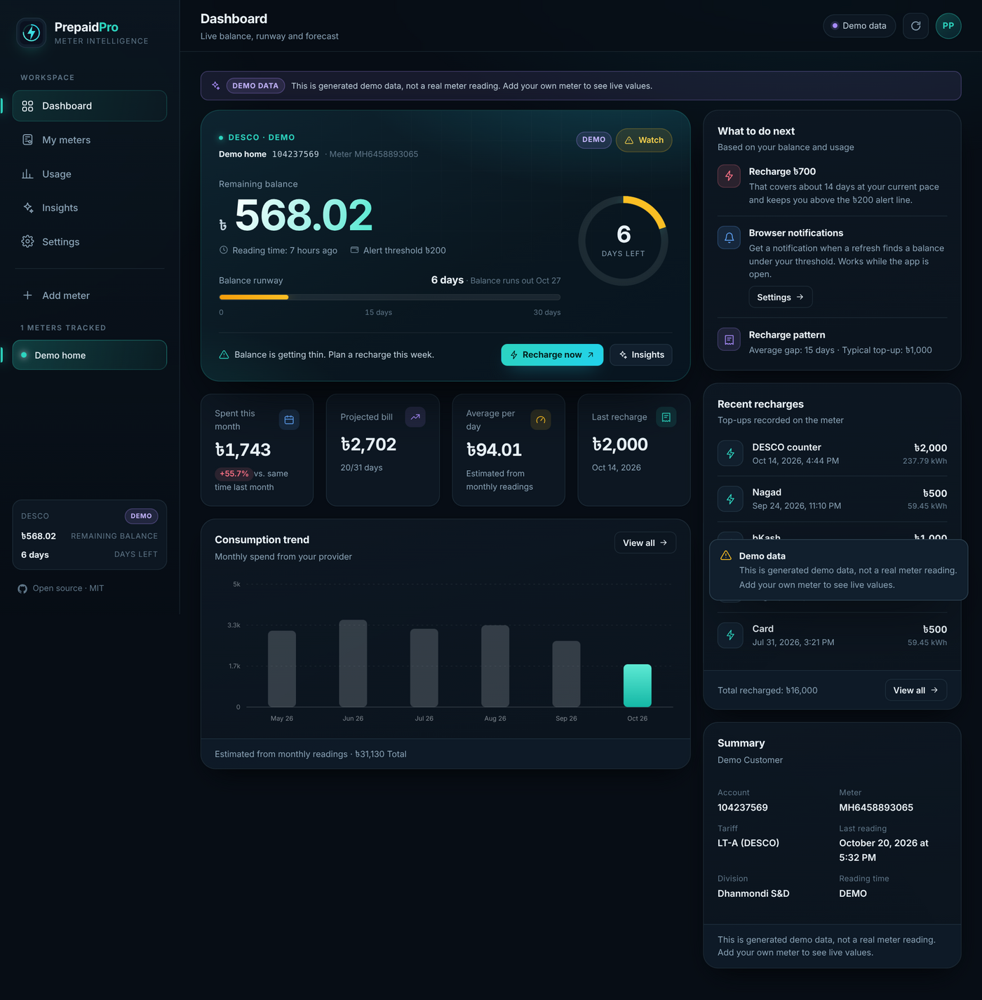
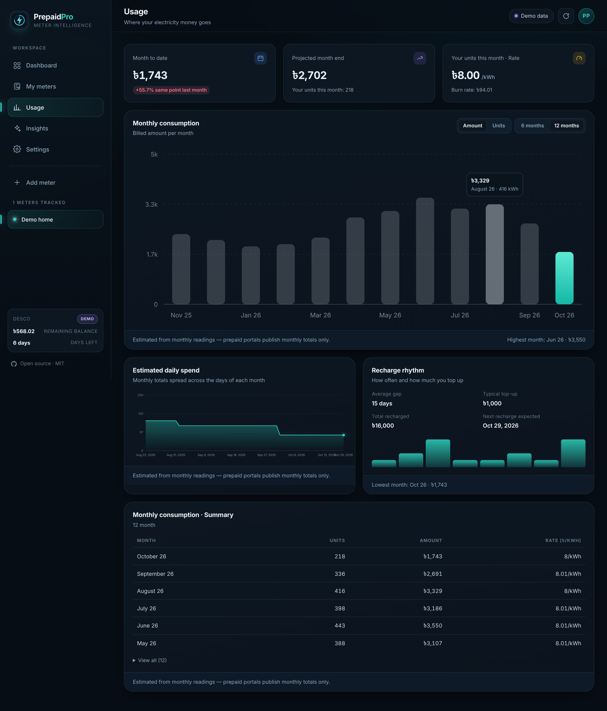
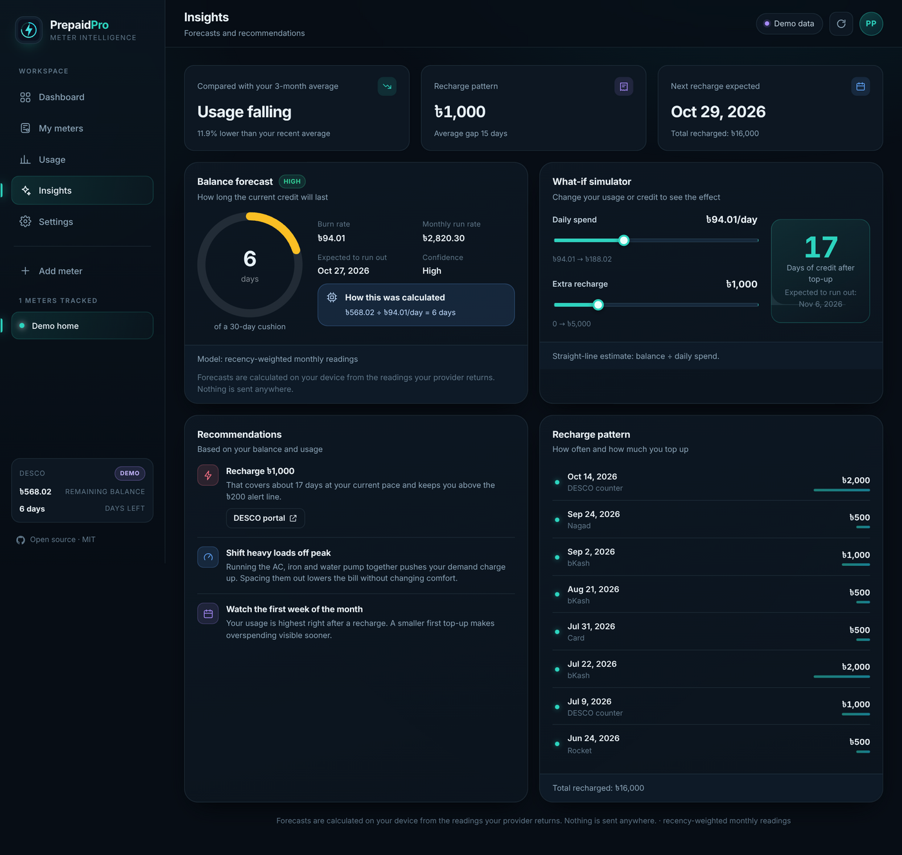
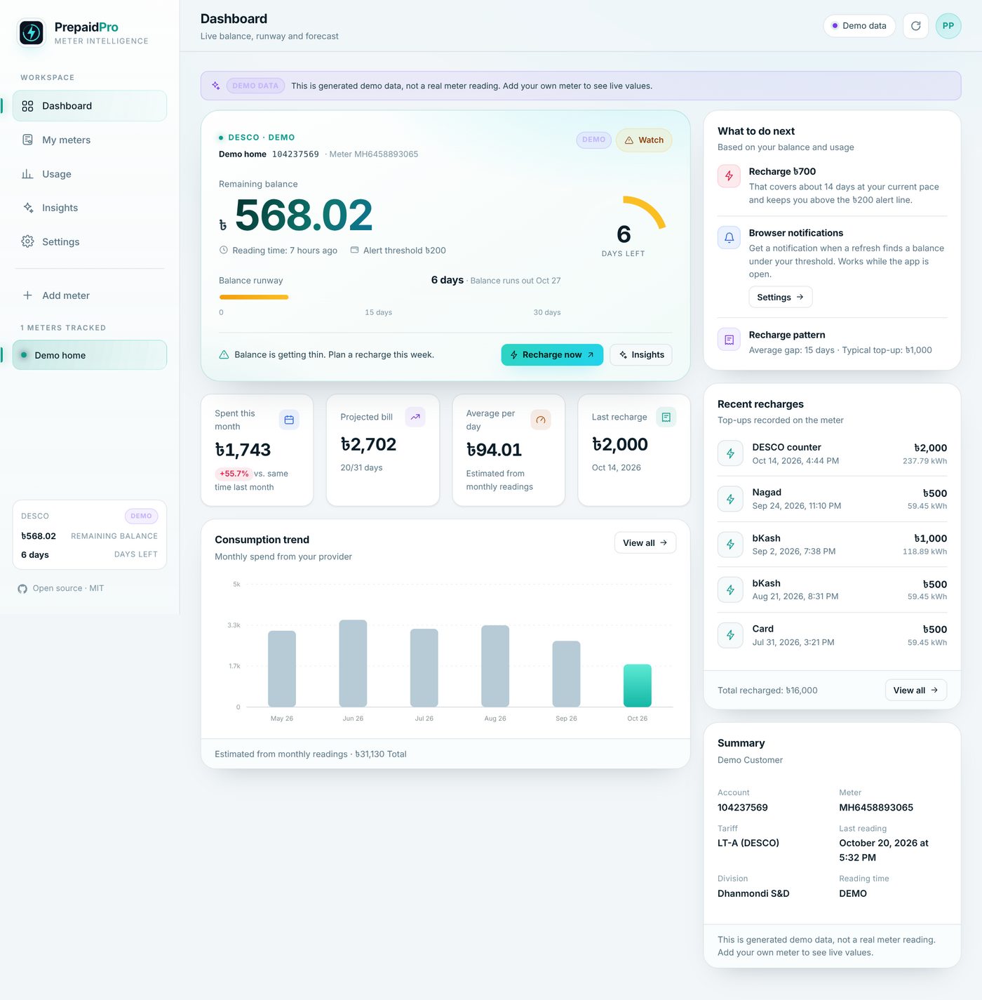
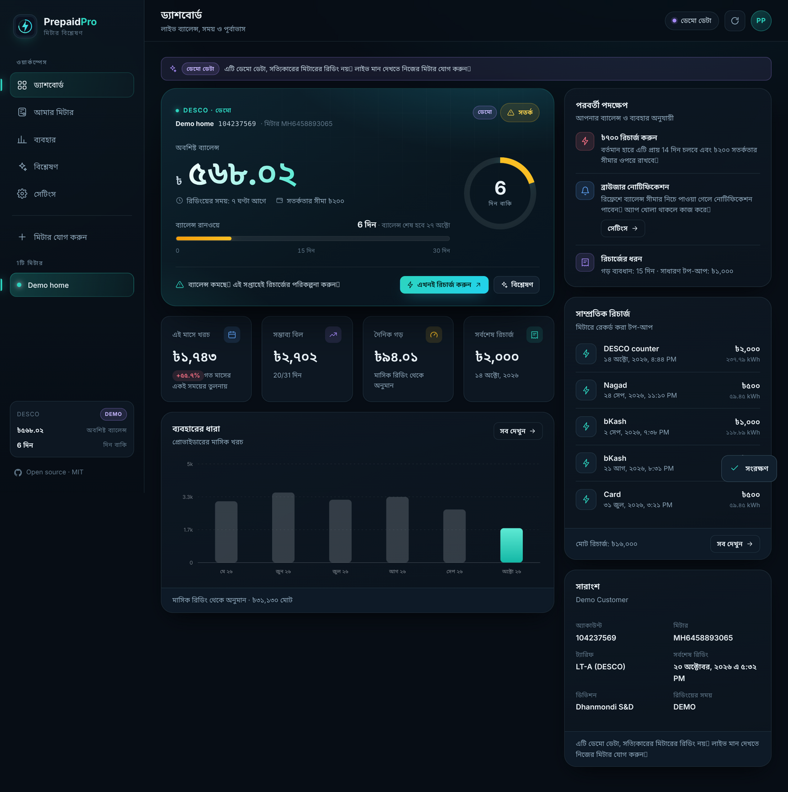
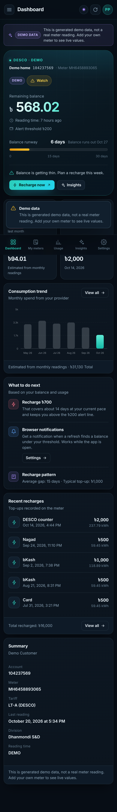

<div align="center">

# ⚡ PrepaidPro

**Open-source DESCO & NESCO prepaid electricity dashboard.**

Know your meter balance, how many days of electricity are left, and when to
recharge — before the lights go out.

[](https://nodejs.org)
[](./LICENSE)
[](#-zero-dependencies)
[](#-tests)

</div>

---

PrepaidPro is a self-hosted web app that reads your DESCO or NESCO prepaid
meter from the official customer portals and turns the raw numbers into
something you can act on: a balance forecast, a burn rate, usage trends and a
recharge recommendation.

It is a complete, runnable implementation of the open-source build described in
the [githud open source ]:live balance, low-balance alerts, recharge history, multiple meters, Bengali and
English, and offline support.
 
<div align="center">

| Dashboard | Usage | Insights |
| --- | --- | --- |
|  |  |  |
| **Light theme** | **বাংলা** | **Mobile** |
|  |  |  |

</div>

## Documentation

- [Product copy deck (English + Bengali)](./docs/APP-COPY.md)
- [Architecture and forecast model](./docs/ARCHITECTURE.md)
- [Privacy policy](./docs/PRIVACY.md)

## Why this exists

A prepaid meter gives you one number: the remaining balance. It does not tell
you that the balance is 6 days of electricity at your current pace, that this
month is running 40 % hotter than last month, or that you should top up ৳800
before Friday. PrepaidPro does that arithmetic for you, on your device.

## Features

- **Live balance** from the official DESCO API or the NESCO customer portal.
- **Days-left forecast.** Recency-weighted burn rate from up to 12 months of
  readings, with an explicit confidence level and a "how this was calculated"
  breakdown — no black boxes.
- **Balance runway.** A 30-day runway gauge that turns amber then red as credit
  runs down, plus the projected date the meter hits zero.
- **Usage insights.** Monthly consumption, estimated daily spend, month-to-date
  vs the same point last month, recharge rhythm, and a what-if simulator.
- **Multiple meters.** Track the flat, the shop and your parents' house; each
  with its own alert threshold.
- **Low-balance alerts.** Browser notifications when a refresh finds the balance
  under your threshold (at most one per meter every 6 hours).
- **Bengali and English**, including Bengali numerals and full Bengali
  typography — self-hosted fonts, no Google Fonts request.
- **Works offline.** A service worker caches the app shell and the last known
  balance, so the dashboard still opens on a dead connection.
- **Dark and light themes**, keyboard shortcuts, print styles, reduced-motion
  support.
- **Zero runtime dependencies.** No build step, no bundler, no framework.

## Quick start

```bash
git clone https://github.com/Sharif1156/PrepaidPro.git
cd PrepaidPro
npm start            # http://localhost:3000
```

That is the whole install. Node.js 20 or newer is required; there is nothing to
`npm install`.

To explore the interface without a meter number:

```bash
DEMO_MODE=1 npm start
```

Demo mode generates deterministic, clearly-labelled sample data for any meter
number. It is also useful on networks that cannot reach Bangladeshi portals
(CI, sandboxes, some corporate VPNs).

## How it works

```
Browser (vanilla ES modules, no build)
   │  GET /api/meter/:provider/:account
   ▼
Node HTTP server (node:http, zero dependencies)
   │  180 s TTL cache + in-flight de-duplication
   ├── DESCO  → https://prepaid.desco.org.bd/api/{tkdes,unified}/customer/…
   └── NESCO  → https://customer.nesco.gov.bd/pre/panel (CSRF + cookies, HTML)
```

- **Forecasting** lives in [`public/js/lib/forecast.js`](./public/js/lib/forecast.js)
  as pure functions and runs in the browser, so your usage history never leaves
  the device. It is covered by unit tests.
- **DESCO** is a public JSON API. Two generations exist (`tkdes` and `unified`);
  the server tries both, because newer meters sometimes return `null` balance on
  the older endpoint.
- **NESCO** has no API. The server replays the portal's own three-step session
  (token → cookie → POST) and parses the HTML with pure, testable functions in
  [`src/nesco.js`](./src/nesco.js).
- **Caching** keeps the portals happy: two tabs refreshing the same meter cause
  one upstream request, not two.

## Configuration

All configuration is environment variables — there is no config file to edit.

| Variable | Default | Purpose |
| --- | --- | --- |
| `PORT` | `3000` | HTTP port |
| `HOST` | `0.0.0.0` | Bind address |
| `DEMO_MODE` | `0` | `1` serves generated demo data instead of live portals |
| `CACHE_TTL_SECONDS` | `180` | How long a meter reading is reused |
| `HISTORY_DAYS` | `335` | Recharge history window (max 730) |
| `RATE_LIMIT_PER_MINUTE` | `30` | Per-IP request budget for `/api/*` |

## API

```
GET /api/health                            server status, demo flag, uptime
GET /api/config                            providers and public configuration
GET /api/meter/:provider/:account          normalised account payload
    ?refresh=1                             bypass the cache
    ?download=1                            same payload as a JSON attachment
GET /api/demo/:provider/:account           generated demo payload
```

A normalised account looks like this (abridged):

```json
{
  "ok": true,
  "account": {
    "provider": "desco",
    "accountNo": "104237569",
    "balance": 1234.56,
    "meterNo": "MH6458893065",
    "readingTime": "2026-10-20T00:00:00+06:00",
    "customer": { "name": "…", "tariff": "LT-A", "division": "Mirpur S&D" },
    "currentMonth": { "month": "2026-10", "taka": 900.1, "unit": 120 },
    "monthly": [{ "month": "2026-09", "unit": 280, "taka": 2100 }],
    "recharges": [{ "date": "2026-10-01T10:00:00+06:00", "amount": 2000, "method": "bKash" }],
    "demo": false,
    "meta": { "cached": true, "cacheTtlSeconds": 180 }
  }
}
```

Errors are always `{ ok: false, error: { code, message, retryable, details } }`
with a machine-readable `code` such as `ACCOUNT_NOT_FOUND`,
`UPSTREAM_UNREACHABLE`, `RATE_LIMITED` or `INVALID_UPSTREAM_RESPONSE`. The UI
maps each code to a specific, honest message.

## Privacy

- Meter numbers and balance snapshots live in this browser's `localStorage`.
  There is no account, no login and no server-side profile.
- The server keeps meter readings in memory for the cache TTL only. Nothing is
  written to disk.
- No analytics, no trackers, no third-party scripts, no advertising SDK. The
  Content-Security-Policy allows `'self'` only.
- **Settings → Delete all data** removes every meter, snapshot and preference.

## Deployment

Any host that runs Node 20 works.

**Render / Railway / Fly.io**

```bash
# start command
node server.js
```

**Docker**

```dockerfile
FROM node:22-alpine
WORKDIR /app
COPY . .
EXPOSE 3000
CMD ["node", "server.js"]
```

**systemd**

```ini
[Unit]
Description=PrepaidPro
After=network-online.target

[Service]
WorkingDirectory=/opt/prepaidpro
ExecStart=/usr/bin/node server.js
Environment=PORT=3000
Restart=on-failure

[Install]
WantedBy=multi-user.target
```

Put it behind Caddy or nginx for TLS. Example Caddyfile:

```
prepaid.example.com {
    reverse_proxy 127.0.0.1:3000
}
```

> **Networking note.** The server must be able to reach
> `prepaid.desco.org.bd` and `customer.nesco.gov.bd`. Some data-centre IP ranges
> are blocked by the utility portals; if lookups time out while the portals work
> in a browser, host the app on a VPS in Bangladesh or run it locally.

## Tests

```bash
npm test     # 43 tests: forecasting maths, both parsers, HTTP surface
npm run check
```

The suite includes fixtures for both portal response shapes, the DESCO payload
variants, the NESCO CSRF/session flow, forecast edge cases (no data, partial
months, zero balance) and an end-to-end check of the HTTP server in demo mode.

## Project structure

```
server.js              HTTP server: routing, caching, rate limiting, static files
src/
  config.js            environment configuration
  errors.js            typed, serialisable application errors
  http.js              fetch wrapper with timeouts and friendly failures
  cache.js             TTL cache with in-flight de-duplication
  desco.js             DESCO API client + normalisation (pure parsers)
  nesco.js             NESCO portal session + HTML parsers (pure parsers)
  demo.js              deterministic demo dataset
public/
  index.html           app shell
  css/app.css          design system (tokens, components, responsive, print)
  js/
    app.js             routing, bootstrap, refresh orchestration
    state.js           localStorage state, meters, settings
    api.js             client for /api
    i18n.js            English + Bengali dictionaries
    format.js          locale-aware money/date/number formatting
    ui.js              DOM helpers, icons, modal, toasts
    charts.js          SVG bar/area/donut/sparkline charts
    lib/forecast.js    forecasting and analytics (pure, tested)
    views/             dashboard, meters, usage, insights, settings, onboarding
  fonts/               self-hosted Inter + Noto Sans Bengali (OFL)
  icons/               PWA icons
  sw.js                offline app shell + last-known balance
test/                  node:test suites
docs/
  APP-COPY.md          every user-facing string, EN + BN
  ARCHITECTURE.md      design decisions, forecast model, resilience
  PRIVACY.md           what is stored, where, for how long
  screenshots/         app screenshots used in this README
```

## Important disclaimers

PrepaidPro is an **independent, unofficial** project. It is not affiliated with,
endorsed by, or operated by DESCO, NESCO or the Government of Bangladesh.

- The DESCO API is public but **undocumented**; it can change without notice.
- The NESCO integration **scrapes** the customer portal, so it is inherently
  more fragile. If NESCO redesigns the page, the parsers in `src/nesco.js` need
  updating — they are isolated and unit-tested for exactly this reason.
- Portal figures can lag the physical meter by up to a day (DESCO's own FAQ says
  the online balance reflects "some time during the last 24 hours"). Always
  confirm on the meter before making a payment decision.
- This project is not a payment app. It never asks for a card, PIN or wallet
  credential. Recharge buttons link to the official portals.

## Licence

MIT. Fonts are SIL Open Font Licensed and ship with their licence files in
`public/fonts/`.
